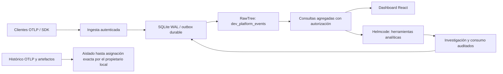

# DevFlight — Agent Observability & Intelligence

Plataforma local de observabilidad multiagente para FME Datathon 2026. RawTree conserva la telemetría analítica; Helmcode investiga mediante herramientas autorizadas; SQLite mantiene identidades, permisos, vistas y una cola durable. El proyecto Qualcomm y las presentaciones existentes son independientes y no se modifican.

## Producto implementado

- Colector OTLP/HTTP JSON y SDK Python; captura ligera, confirmación durable, reintentos y deduplicación estable.
- FastAPI y React/TypeScript con Tailwind y Apache ECharts: Overview, Agents, Sessions & Traces, People & Teams, Usage & Costs, AI Analyst, Settings y Data Explorer.
- Exploración de campos permitidos, filtros por período/sesión/proveedor/modelo/equipo/usuario/proyecto/ejecución, agrupaciones, páginas de 100 filas, vistas privadas y exportación CSV limitada.
- Organizaciones y membresías, equipos, proyectos, roles `admin`, `team_manager`, `member`, `viewer`; credenciales personales revocables. La organización y el usuario se obtienen de la credencial, no del JSON del cliente.
- AI Analyst real con Helmcode: selección de herramientas, consultas RawTree, evidencia SQL, conclusión, recomendaciones y auditoría. No dispone de SQL arbitrario ni de acciones sobre agentes externos.



## Inicio en Windows CMD

Python 3.11 o posterior. La compilación está incluida; Node solo es necesario para modificar el frontend.

```cmd
py -3 -m venv .venv
.venv\Scripts\python.exe -m pip install ".[platform]"
copy .env.example .env
```

Configura privadamente `RAWTREE_API_KEY`, `RAWTREE_READ_KEY`, `HELMCODE_API_KEY`, `HELMCODE_BASE_URL=https://api.helmcode.com/v1` y `HELMCODE_MODEL=qwen3.6`. El ejemplo no contiene credenciales.

```cmd
devflight.cmd start
```

Abre `http://127.0.0.1:8788`. El primer inicio guarda la credencial personal de administración en `.devflight/platform/admin.token`; úsala en el formulario local, sin compartirla. Las claves maestras permanecen en backend. `devflight.cmd status`, `restart` y `stop` administran los servicios. No se abren agentes ni se modifican sus configuraciones globales.

La aplicación escucha solo en loopback. Es un despliegue local, no un servicio público certificado: HTTPS, SSO, rotación centralizada y despliegue corporativo requieren preparación adicional. En Windows, los archivos privados heredan las ACL del usuario; no compartas `.devflight`.

## Captura de varios agentes

En Settings crea usuarios y claves de ingesta individuales; configura su Bearer en los exportadores oficiales. El API autenticado acepta `/v1/logs`, `/v1/traces`, `/v1/metrics` en el puerto **8788**, además de eventos normalizados en `/api/events`. El colector dedicado **8787**, cuando arranca en modo enterprise, utiliza las mismas credenciales y almacenamiento. Cada cliente debe elegir un único destino para evitar enviar dos veces su actividad.

- Codex: exportador OTLP/HTTP JSON y `otel.trace_exporter='none'`, `otel.log_user_prompt=false` en el perfil essential. Detailed/debug habilitan trazas explícitamente. Los controles y cabeceras dependen de la versión del cliente.
- Claude Code: variables oficiales `CLAUDE_CODE_ENABLE_TELEMETRY`, exportadores OTLP de logs/métricas, protocolo `http/json`, endpoint y cabeceras de autorización.
- Gemini CLI y Qwen Code: ajustes oficiales `telemetry.enabled`, endpoint, protocolo `http`, `logPrompts=false`; desactivar trazas detalladas cuando la versión ofrezca ese ajuste.
- Otros clientes: SDK o integración OTLP compatible. No se inspeccionan procesos, tráfico privado ni razonamiento interno.

La configuración inicial requiere autorización y backup. El comando existente `start_devflight.py integrations --configure ...` conserva el flujo interactivo; ajustes existentes y cabeceras privadas requieren fusión manual. Reinicia las sesiones del proveedor tras configurar. La aplicación no puede activar retroactivamente OTLP en una sesión ya abierta.

Si hay un colector antiguo en 8787 sin API de parada autenticada, el launcher lo conserva y utiliza 8788 para la ingesta multiempresa. No mata un proceso sin identidad verificada ni debilita su autenticación. La plataforma puede reiniciarse independientemente; ese colector antiguo requiere su mecanismo original de parada antes de migrar a la versión nueva.

## Datos, métricas y privacidad

`dev_platform_events` contiene dimensiones mínimas, sin prompts, código, argumentos ni resultados de herramientas completos. Los atributos específicos no autorizados se omiten en esta ruta. El colector legacy conserva su formato previo y sus tablas nativas; esos históricos no se asignan automáticamente a ninguna empresa.

Data Explorer reconoce `dev_logs`, `dev_traces`, `dev_metrics`, `dev_events_raw` y `dev_artifacts_raw`. Solo el propietario local inicial puede asignar una traza histórica exacta a una organización mediante una acción explícita. Las consultas de históricos asignados se limitan a administradores, a esa traza y a campos seguros; no exponen prompts, `event_json` completo ni chunks de artefactos. El SDK/restaurador legacy sigue disponible por CLI.

Las filas no equivalen a solicitudes. Los tokens desconocidos siguen siendo null. No se suman muestras acumulativas OTLP ni tokens de spans junto a los logs de usage. La ruta normalizada promueve consumo de logs explícitos de uso y de productores SDK que informan consumo por evento; es una cobertura limitada, no una contabilidad universal. Las tarifas desconocidas no se inventan. Los costes mostrados son únicamente valores observados enviados por la fuente.

Las consultas usan los esquemas reales y agregaciones en servidor, con caché corta separada por organización, usuario, rol, equipo y SQL. La retención de caché/snapshots está acotada. El modo snapshot muestra resultados previamente verificados para exactamente el mismo alcance autorizado y los etiqueta como históricos; no simula una conexión o inferencia en directo.

## Helmcode y límites

La cuenta se consultó realmente: `qwen3.6` y `gemma4` están disponibles. Se seleccionó `qwen3.6`, con 3B parámetros activos según la documentación oficial, incluido en el catálogo del plan y con function calling; se desactiva reasoning para reducir consumo. No se seleccionan modelos premium ni se escala silenciosamente.

Configurables: salida 512 tokens, 3 iteraciones, 4 consultas, presupuesto total observado 6.000 tokens y timeout 60 s; límites máximos acotados en código, dos investigaciones concurrentes y sin reintentos de inferencia ocultos. La detección periódica del panel solo consulta errores; iniciar una investigación es una acción explícita. Consultas internas y consumo del analista quedan fuera de los disparadores de fallos de desarrollo.

El analista guarda evidencia y uso realmente reportado; no conserva `reasoning_content`. Los resultados de telemetría son datos no confiables. El backend valida herramientas y parámetros e inserta los filtros autorizados; la IA no puede escoger otra organización, ejecutar SQL destructivo ni lanzar acciones sobre otros agentes. [Modelos y capacidades oficiales](https://helmcode.com/docs/models).

## Durabilidad y retención

SQLite WAL con confirmación FULL, outbox indexado y manifiesto durable de lote: un timeout ambiguo conserva la identidad del lote aunque lleguen nuevos eventos. El uploader es independiente de la interacción del agente. `DEVFLIGHT_PLATFORM_MAX_BYTES` limita por defecto a 512 MiB la base y archivos de archivo; al saturarse se rechazan nuevas confirmaciones con error reintentable. No se borra telemetría confirmada.

Settings permite archivar payloads confirmados después de 7 días o desactivar el archivado. Los archivos gzip conservan íntegramente las filas; nunca se archivan pendientes ni se eliminan históricos. El índice mínimo de IDs se conserva para deduplicar. Esto reduce payloads activos, no promete almacenamiento histórico infinito. El límite de la cola legacy es independiente (`DEVFLIGHT_MAX_QUEUE_BYTES`). Los exportadores deben respetar 503/Retry-After y sus propios límites de reintentos.

## Demostración y desarrollo observado

```cmd
.venv\Scripts\python.exe scripts/platform_demo.py
.venv\Scripts\python.exe scripts/platform_demo.py --live
```

Ambos ejecutan una compilación Python real, capturan metadatos SDK, comprueban un ID exacto en RawTree y en la API del dashboard y verifican la auditoría remota. El primer comando utiliza una investigación ya verificada y lo etiqueta `verified-history-replay-no-new-inference`; necesita haber ejecutado antes una investigación. `--live` realiza una nueva investigación Helmcode acotada. No genera actividad falsa de proveedores.

La implementación actual se instrumentó explícitamente con la ejecución `b07066fb-8003-4f30-b235-ad393e2125fa`. Incluye regresiones reales, builds y observaciones de hashes de archivos autorizados, sin contenido. Es cobertura parcial del trabajo, no captura completa de Codex ni de actividad anterior. Helmcode investigó sus errores usando herramientas reales.

## Verificación y límites conocidos

```cmd
.venv\Scripts\python.exe -m unittest discover -s tests -q
npm.cmd --prefix frontend ci
npm.cmd --prefix frontend run build
```

[Resultados verificables](documentation/VALIDATION.md) y [rendimiento](documentation/PERFORMANCE.md). No se certifica latencia interactiva de Codex ni sesiones reales de proveedores no instalados. El host de navegador no estuvo disponible: compilación y API probadas, revisión visual pendiente. La aplicación es funcional en local; no se presenta como una auditoría de seguridad para exposición pública.
