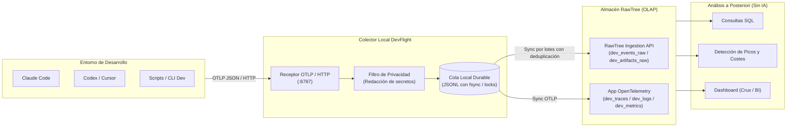

# Observabilidad de Agentes de IA con RawTree y OpenTelemetry (DevFlight)

**Fase actual: captura e ingesta, sin dashboard ni analista.** Guía operativa: [TELEMETRY_QUICKSTART.md](documentation/TELEMETRY_QUICKSTART.md). Usar `fme-trace collect` para el receptor dedicado y `fme-trace run` para agentes CLI; `run` sincroniza automáticamente al terminar. El servidor `serve` pertenece a la demo anterior.

Plataforma de observabilidad y centralización de telemetría para **agentes y subagentes de desarrollo con IA (Claude Code, Codex, Cursor, CLI)** hacia **RawTree**, utilizando **OpenTelemetry (OTLP)** y una cola local durable.

Este proyecto actúa como un **complemento totalmente independiente** al reto principal de Qualcomm (Math Copilot en Arduino UNO Q): su misión es capturar, proteger y almacenar de forma indiscriminada toda la telemetría de las IAs y herramientas que los desarrolladores utilizan durante la construcción del proyecto Qualcomm, dejándola estructurada y disponible en RawTree para análisis analíticos y consultas SQL posteriores.

---

## Propósito y Filosofía del Proyecto

1. **Problema:** En equipos u organizaciones donde múltiples programadores utilizan agentes de IA en paralelo (Claude Code, Codex, scripts autónomos), no hay visibilidad centralizada sobre el volumen de tokens consumido, la frecuencia de llamadas a herramientas, los errores o los picos anómalos de gasto.
2. **Nuestra Solución:** Un pipeline de telemetría agnóstico que recibe indiscriminadamente todos los eventos emitidos por las herramientas de desarrollo mediante OpenTelemetry (OTLP) o HTTP, los almacena localmente en una cola durable resistente a fallos de conexión, y los ingiere en **RawTree (Tinybird OLAP)** sin requerir un esquema estricto previo.
3. **Sin agentes de IA internos:** **Este proyecto no utiliza LLMs ni APIs externas de IA para analizar los datos.** No se requiere machine learning ni modelos adicionales. El valor reside en la captura fiel, redacción de secretos, resiliencia offline y almacenamiento OLAP en RawTree, permitiendo que analistas humanos o herramientas SQL auditen los patrones de uso a posteriori.
4. **Conexión con los Agentes (MCP y OTLP):** Los agentes de programación (Claude Code, Codex, etc.) se conectan a este ecosistema mediante exportadores estándar de OpenTelemetry y el servidor MCP de RawTree para registrar y consultar telemetría.

---

## Arquitectura



---

## Inicio Rápido

### 1. Variables de entorno (`.env`)
Configura las credenciales de RawTree en el archivo `.env` (basado en `.env.example`, cargado automáticamente por los scripts):

```env
RAWTREE_API_KEY=05bb7558-6f5e-4a0d-acdd-55ac53886e8d
RAWTREE_READ_KEY=05bb7558-6f5e-4a0d-acdd-55ac53886e8d
RAWTREE_BASE_URL=https://api.rawtree.com
RAWTREE_DATABASE=datathon_mathops
DEVFLIGHT_HOME=.devflight
DEVFLIGHT_OFFLINE=0
```

### 2. Iniciar el receptor de telemetría local
Ejecuta el servicio de ingestión (escucha en `http://127.0.0.1:8787`):

```powershell
./.venv/Scripts/fme-trace.exe --home .devflight/telemetry collect --port 8787
```

### 3. Configurar OpenTelemetry en los agentes / herramientas
Cualquier proceso o agente instrumentado con OpenTelemetry puede enviar sus trazas y métricas configurando los endpoints estándar:

```sh
export OTEL_EXPORTER_OTLP_PROTOCOL="http/json"
export OTEL_EXPORTER_OTLP_ENDPOINT="http://127.0.0.1:8787"
```

El receptor local acepta `/v1/traces`, `/v1/logs`, `/v1/metrics` y `/events` genéricos.

### 4. Sincronizar hacia RawTree
Para vaciar la cola local hacia las tablas de RawTree:

```powershell
./.venv/Scripts/fme-trace.exe --home .devflight/telemetry sync
```

---

## Qué Datos se Almacenan Indiscriminadamente en RawTree

RawTree almacena los eventos semiestructurados sin forzar tipos rígidos:
- **Metadatos de sesión:** `timestamp`, `developer_id`, `session_id`, `agent_id`, `model`.
- **Cómputo y costes:** Tokens de prompt, tokens de respuesta, tokens en caché y latencias.
- **Herramientas invocadas:** Nombres de herramientas, argumentos pasados y respuestas devueltas.
- **Árbol de ejecución:** `trace_id`, `span_id` y `parent_span_id` para reconstruir la relación entre agentes y subagentes.
- **Salidas observables y artefactos:** Mensajes de consola (stdout/stderr), diffs de código y hashes SHA-256 de archivos creados.
- **Errores:** Códigos de fallo, excepciones y códigos de salida.

---

## Resiliencia y Privacidad (Local-First)

- **Redacci?n de patrones conocidos:** El motor de redacción (`redact()`) filtra automáticamente tokens Bearer, contraseñas, claves privadas y patrones de claves API (`sk-*`, `rt_*`, `ghp_*`, etc.) antes de persistir nada a disco o enviarlo a la red.
- **Tolerancia a cortes (`DEVFLIGHT_OFFLINE=1`):** Si se pierde la conexión o el desarrollador trabaja en un entorno cerrado (como una red de pruebas offline), los eventos se acumulan de forma segura en disco con `fsync` y bloqueos de proceso (`file_lock`). Al restablecer la conectividad, `fme-trace sync` transfiere los lotes con identificadores de deduplicación estables sin duplicar registros.

---

## Consultas SQL de Ejemplo en RawTree

Una vez en RawTree, los datos quedan disponibles para auditoría directa sin necesidad de modelos de IA:

```sql
-- 1. Consumo total de tokens y peticiones por modelo
SELECT 
    JSONExtractString(__raw_data, 'model') AS model_name,
    count() AS total_requests,
    sum(toUInt64OrZero(JSONExtractString(__raw_data, 'prompt_tokens'))) AS total_prompt_tokens
FROM dev_events_raw
WHERE event_type = 'llm.response'
GROUP BY model_name
ORDER BY total_prompt_tokens DESC;

-- 2. Detección de picos temporales de actividad de agentes
SELECT 
    toStartOfHour(parseDateTimeBestEffort(timestamp)) AS hour_window,
    count() AS event_count,
    uniqExact(JSONExtractString(__raw_data, 'agent')) AS active_agents
FROM dev_events_raw
GROUP BY hour_window
ORDER BY hour_window DESC;

-- 3. Tasa de errores por desarrollador o sesión
SELECT 
    JSONExtractString(__raw_data, 'developer_id') AS developer,
    countIf(event_type = 'error') AS total_errors,
    count() AS total_events
FROM dev_events_raw
GROUP BY developer;
```

---

## Documentación Relacionada

- [Visión completa de Observabilidad con RawTree](documentation/OBSERVABILIDAD_AGENTES_RAWTREE.md)
- [Contexto del reto Qualcomm](documentation/RETO_QUALCOMM_CONTEXTO.md)
- [Enunciado del reto RawTree](documentation/RAWTREE_SIDE_CHALLENGE.md)
- [Adaptadores de telemetría y OTLP](documentation/ADAPTERS.md)
- [Guion de Demo de 3 minutos](documentation/DEMO.md)
- [Validación técnica y pruebas](documentation/VALIDATION.md)
