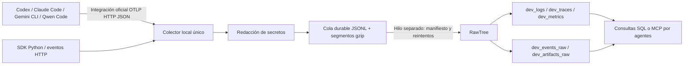

# DevFlight — AI Agent Telemetry

DevFlight es el side challenge de RawTree del equipo Relus (Etna, Guillem y Nestor) en la FME Datathon 2026. Hace observable el trabajo de agentes de programación: sesiones, herramientas, errores, modelos, tokens y duraciones cuando el proveedor los emite.

**Entrega actual: captura, persistencia offline, sincronización y consulta.** No incluye un dashboard empresarial ni un AI Analyst autónomo terminado. El proyecto matemático Qualcomm es independiente y no necesita RawTree para funcionar offline.

## Arquitectura



OTLP solo se envía a sus tablas nativas; los sobres se conservan localmente. Los eventos SDK/HTTP van a `dev_events_raw`. Los artefactos tienen una tabla adicional para restauración. El colector confirma HTTP después de escritura durable; ninguna petición espera a una subida a RawTree.

## Windows CMD

Requiere Python 3.11 o posterior. El runtime no tiene dependencias externas.

```cmd
py -3 -m venv .venv
.venv\Scripts\python.exe -m pip install -e .
copy .env.example .env
.venv\Scripts\python.exe start_devflight.py start
.venv\Scripts\python.exe start_devflight.py status
```

Configura las claves privadas de ingesta y lectura en `.env`. Nunca se deben subir a Git. `start` inicia silenciosamente un único colector en segundo plano, sin abrir agentes. `stop` solicita una parada autenticada; `doctor` comprueba configuración y acceso remoto. `start --with-codex` abre una sesión opcional de Codex sin alterar su configuración global. El launcher PowerShell histórico delega en este mismo punto de entrada.

## Integraciones y privacidad

`integrations` informa de ajustes detectables y actividad local. `integrations --configure codex` (también `gemini_cli` o `qwen_code`) muestra el cambio de telemetría, pide `YES`, crea un backup y escribe atómicamente. Si ya hay ajustes de telemetría, exige una fusión manual. No modifica automáticamente configuraciones del usuario.

- **Codex CLI:** exportador `otel.exporter` OTLP/HTTP JSON a `/v1/logs`. El perfil `essential` desactiva explícitamente `otel.trace_exporter`, incluso ante ajustes heredados. `DEVFLIGHT_CAPTURE_PROFILE=detailed` o `debug` habilita trazas; ambos conservan los límites y la redacción.
- **Claude Code:** configuración manual de entorno de usuario: `CLAUDE_CODE_ENABLE_TELEMETRY=1`, `OTEL_LOGS_EXPORTER=otlp`, `OTEL_METRICS_EXPORTER=otlp`, `OTEL_EXPORTER_OTLP_PROTOCOL=http/json` y endpoint local `http://127.0.0.1:8787`. No confundir configuración detectable con sesión verificada.
- **Gemini CLI:** ajustes oficiales `telemetry.enabled`, `otlpEndpoint`, `otlpProtocol=http`, `logPrompts=false` y `traces=false`.
- **Qwen Code:** ajustes oficiales de telemetría HTTP/JSON y `logPrompts=false`. Los controles de trazas dependen de la versión del proveedor.
- **Otros clientes:** OTLP/HTTP JSON, SDK Python `Queue`/`Trace` o `/events`. No hay captura universal, inspección de procesos ni interceptación de tráfico.

Los agentes necesitan una nueva sesión después de configurar su exportador. Si se usa `DEVFLIGHT_HTTP_TOKEN`, deben enviar `Authorization: Bearer …`. El servicio solo escucha en loopback, valida Host/Origin y protege `/shutdown` además con una clave local. En Windows los permisos del directorio siguen las ACL del usuario: no compartir `.devflight`. La redacción no equivale a una política DLP completa; no habilitar prompts/código sensible en el proveedor. Los valores ausentes no son consumo cero; el JSON heterogéneo y los null explícitos se preservan.

## Durabilidad y límites

Secuencia recuperable, manifiestos durables, cursor confirmado y tokens de deduplicación estables. Los errores parciales OTLP dejan el lote pendiente. Hasta 32 solicitudes de ingesta activas, cuerpos de hasta 4 MiB; saturación o fallo de disco devuelve `503` con `Retry-After`.

`DEVFLIGHT_MAX_QUEUE_BYTES` limita opcionalmente los archivos de telemetría; `0` conserva histórico sin límite. Al llenarse, no borra datos: rechaza nuevas confirmaciones para que el exportador reintente. El proveedor puede agotar sus propios reintentos. No hay eliminación automática por retención; el estado confirmado se compacta mediante cursor y los segmentos se comprimen. Los logs/manifiestos no se incluyen en este límite. Un ciclo de sync aún carga una instantánea del histórico: no es una cola indexada de escala ilimitada.

## Pruebas y demostración

```cmd
.venv\Scripts\python.exe -m unittest discover -s tests -q
.venv\Scripts\python.exe scripts/rawtree_verify.py --home .devflight/demo-verification
```

La segunda orden requiere RawTree y genera solo ocho eventos de prueba identificados por agente `live-probe`; recupera por SQL esos eventos y un artefacto. No consume tokens de modelos. Los tests usan colas temporales y clientes simulados para reintentos, además de HTTP local real. [Resultados y límites](documentation/VALIDATION.md), [rendimiento](documentation/PERFORMANCE.md).

## Uso agéntico y entrega

RawTree admite JSON heterogéneo, tablas OTLP y consultas SQL/MCP. Un agente conectado a su MCP puede investigar su historial: por ejemplo, agrupar spans por operación y comparar `count()` con `uniqExact(tuple(traceId, spanId))` para distinguir volumen interno de duplicación. La investigación de esta entrega se realizó con consultas reales; un AI Analyst autónomo integrado es trabajo pendiente. No se presenta como implementado.

El enunciado pide que el agente protagonice la ingesta, consulta y decisión; la fase actual aporta la base de datos y captura verificadas para ese objetivo, pero aún no cumple por sí sola todo el ciclo autónomo. [Enunciado oficial](documentation/RawTree%20-%20Side%20challenge.pdf).

[Pitch editable](deliverables/Datathon_2026_Final_Pitch.pptx) · [Pitch PDF](deliverables/Datathon_2026_Final_Pitch.pdf). Ocho diapositivas con notas para unos tres minutos. El ≈46 % comunicado para Qualcomm sigue provisional; no se localizó una evaluación reproducible ni se verificó el despliegue del equipo en UNO Q. Los archivos `copilot/`, `board/` y sus herramientas se conservan por compatibilidad, sin cambios en esta entrega.

`integrations` tiene alcance diagnóstico limitado: `configured` detecta ajustes para el puerto predeterminado 8787 y el entorno del proceso; `emitting` identifica coincidencias históricas de nombre en la cola, no un heartbeat. Los alias y las versiones concretas requieren validación con cada proveedor. Las identidades de un sobre OTLP ambiguo se omiten; los atributos originales por recurso/log/span/datapoint permanecen disponibles para distinguir sesiones.
